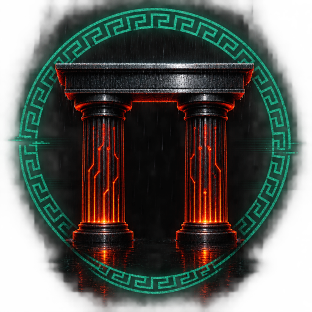
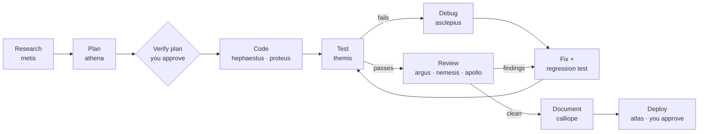

<p align="center">
  
</p>

#  Pantheon

**An AI team and harness for Claude Code.** Eleven specialist agents, orchestration commands, agentic-programming skills, a safety hook, and a curated, reproducible collection of ~175 skills (from [skills.sh](https://skills.sh)) and plugins. Install it all, or any part of it, onto any machine with `make`, and remove it again cleanly.

```bash
git clone https://github.com/pooyagolchian/pantheon ~/pantheon && cd ~/pantheon
make plan        # dry run: shows exactly what would change
make install     # core + team + skills
make doctor      # verify
```

New here? Run `/pantheon:onboard` (or `/onboard` after a Makefile install) for a guided tour that checks your setup and suggests a safe first task. You can also paste [`ONBOARDING.md`](plugins/pantheon/ONBOARDING.md) into Claude Code.

## The full lifecycle: plan → verify → code → test → debug → fix → deploy

Pantheon runs a change through the whole development loop. Each stage goes to a specialist with its own fresh context and its own gate, and the lead session (Zeus) only moves on when that gate passes.



| Stage | Who | Command | What the stage has to show before the next one starts |
|---|---|---|---|
| **Research** | `metis` | `/scout` | Sourced answers from current docs (via ctx7) and the codebase, not from memory |
| **Plan** | `athena` | `/assemble` step 2 | A design and ordered tasks grounded in the real code. Each task has files, a done-check and a test |
| **Verify the plan** | you | `/assemble` stops here | You approve when the plan has risky or irreversible steps or open questions. Nothing is built before that |
| **Code** | `hephaestus` (new behaviour), `proteus` (restructuring) | `/forge <plan>` | Test-first: a failing test, then the code, matching the surrounding style. `proteus` pins current behaviour with characterisation tests before moving anything |
| **Test** | `themis` | `/assemble` step 6 | The suite, type checker and linter run for real, plus an end-to-end check of the actual app (`verify-app`), with saved evidence |
| **Debug** | `asclepius` | ask: "why is this failing" | The root cause, reproduced, before anyone proposes a fix |
| **Fix** | the builder, resumed with findings | `/assemble` step 5 | A fix plus a regression test that fails without it. At most 5 fix rounds, then it stops and reports instead of looping |
| **Review** | `argus` (correctness), `nemesis` (security), `apollo` (UI and accessibility) | `/council` | Independent reviewers who see the diff, not the builder's reasoning, run in parallel. Unsubstantiated findings are dropped |
| **Document** | `calliope` | `/assemble` step 7 | README, docs, changelog and ADRs checked against the code that shipped |
| **Deploy** | `atlas` + `calliope` | `/ship` | Version bump, a green gate, exact release commands and a rollback. Nothing is tagged, pushed or deployed until you approve those commands |

`/assemble <task>` runs the whole loop. You can also run any stage on its own: `/scout` to research, `/forge` to build a plan you already have, `/council` to review a diff, `/ship` to release.

### Why this gets more out of Claude

- **Focused context per stage.** A long single session fills up with file dumps and dead ends. Each specialist starts clean with a brief written for its job, and only its conclusion comes back to the lead.
- **Plans before code.** Most wasted work comes from building the wrong thing. Planning against the real codebase and pausing for your approval catches that while it is still cheap.
- **Tests that bite.** Builders write the test first, and fixes come with a regression test. A test that would still pass if the change were reverted doesn't count.
- **Review that isn't anchored.** Reviewers get the diff and the goal, not the builder's opinion of the diff, so they find what the builder missed rather than agreeing with it.
- **Verified, not reported.** Subagent reports are claims. The lead re-runs the decisive check itself before saying anything is done.
- **Bounded loops and gated actions.** Fix rounds are capped. Anything outward-facing (push, publish, deploy) waits for you, and the guard hook stops the worst commands outright.
- **Measured.** `make eval` runs the same tasks with and without the plugin and reports the difference. See [Evals](#evals) for what it shows today.

## The team

The main session is **Zeus**, the lead: it holds your intent, delegates, integrates and verifies. The specialists are subagents. For their portraits, a detailed look at each one's job, and proposals for improving them, see **[Meet the team](docs/team.md)**.

| Agent | Role | Edits code | Model |
|---|---|---|---|
| `metis` | researcher: docs (via ctx7), codebase, web | — | sonnet |
| `athena` | architect: design + task plan | — | opus |
| `hephaestus` | builder: implements one task, test-first | ✓ | inherit |
| `asclepius` | debugger: root cause, then fix + regression test | ✓ | inherit |
| `proteus` | refactorer: restructures without changing behavior, pinned by tests | ✓ | inherit |
| `argus` | reviewer: correctness, regressions, silent failures | — | opus |
| `nemesis` | security red team: attack paths | — | opus |
| `apollo` | UI critic: design, accessibility, responsive checks on the running app (browser tools need the `playwright` plugin from `make install-plugins`) | — | sonnet |
| `themis` | verifier: tests + end-to-end proof | tests | inherit |
| `atlas` | devops: CI/CD, infra, releases (prepares, never fires) | ✓ | inherit |
| `calliope` | writer: README, ADRs, changelogs, PR text | docs | sonnet |

### Commands

| Command | What it does |
|---|---|
| `/assemble <task>` | Full pipeline: scout → plan → build → review → fix → verify → document |
| `/council [target]` | argus + nemesis + themis review a diff in parallel (plus apollo when UI changed); one ranked table |
| `/forge <plan>` | Execute a plan task by task, with review per task |
| `/scout <question>` | metis researches and returns a sourced answer |
| `/handoff [path]` | Write `HANDOFF.md` so a fresh session can continue |
| `/ship [version]` | atlas prepares the release (version, checks, exact commands, rollback) and calliope writes the changelog; stops for your approval |
| `/onboard` | Guided first-run tour: checks your setup, explains the team, suggests a first task |

### Skills that ship with the team

- `pantheon-orchestration`: when to delegate, how to brief, parallelism, verifying subagents.
- `agentic-workflow`: the explore → plan → implement → verify → commit loop.
- `context-engineering`: CLAUDE.md, rules, skills, hooks and memory, and where each belongs.
- `harness-engineering`: settings, permissions, hooks, agents, plugins and marketplaces.
- `verify-app`: proves a change works by driving the real app (browser, CLI/TUI, HTTP API) against acceptance checks, asserting on state and saving evidence. `themis` uses it.
- `brand`: extracts a brand profile (`BRAND.md`: facts, voice, visual identity, imagery, SEO/AEO entity data) from a website or repo, then writes copy and reviews UI against it. Works for any company, product or personal brand.
- `engineering-principles`: code-craft rules models get wrong: a fail-loud error contract, validating at boundaries, diff discipline, deep modules, and tests that actually assert.
- `backend-service-checklist`: production readiness for services and APIs: timeouts, retries with jitter, idempotency keys, cursor pagination, backpressure, graceful shutdown.
- `typescript-conventions`: a strict tsconfig baseline, narrowing over casting, discriminated unions, branded types, and an explicit error policy.
- `design-principles`: one design reference distilled from the best design skills, with exact numbers for spacing, type, OKLCH color and contrast, motion and states. It resolves the conflicts between sources and lists the AI-UI tells to avoid.
- `changing-legacy-code`: change untested code safely: pinch points, the smallest seam, sprout and wrap, a light Mikado loop, branch by abstraction.
- `test-portfolio-and-doubles`: choose the test level from risk, state-based by default, a fake/stub/mock/spy decision table, the outside-in double loop.
- `module-boundaries`: enforce dependency direction with dependency-cruiser, eslint-plugin-boundaries, knip and import-linter, using ratchet baselines so existing code can adopt them gradually.
- `engineering-principles` also has a patterns reference that maps each GoF pattern to its native TypeScript or Python idiom and lists SOLID over-use smells.

### Works alongside other plugins

Pantheon provides the team and the pipeline. It doesn't re-implement techniques that other plugins already do well. If [superpowers](https://github.com/obra/superpowers) is installed, the agents use its TDD, planning, debugging and worktree skills. For writing and evaluating skills, they use Anthropic's `skill-creator` and `claude plugin eval`.

## What gets installed

| Part | Target (`~/.claude/…`) | Contents |
|---|---|---|
| `core` | `rules/`, `statusline.sh`, `settings.json` | global working rules, ctx7 rule, statusline, `skillOverrides`, guard hook |
| `team` | `agents/`, `commands/`, `skills/` | the Pantheon plugin, symlinked so edits in the repo are live |
| `skills` | `skills/` | `skills/manifest.tsv` installed via skills.sh, plus vendored skills |
| `plugins` | Claude plugin system | marketplaces + plugins from `plugins.tsv` (only with `install-all` / `install-plugins`) |

```bash
make install                         # core + team + skills
make install-all                     # … + plugins
make install-team                    # just one part (also: -core, -skills, -plugins)
make install PROFILES="core frontend"
make uninstall                       # removes only what Pantheon installed
```

### Skill profiles

Every skill in `skills/manifest.tsv` has a profile. Run `make profiles` for counts and `make list` for names.

`core` · `engineering` · `frontend` · `design` · `marketing` · `docs` · `career`

Installing every skill costs context in every session (each description is always loaded), so pick the profiles you need on a given machine. Rarely used skills can be set to `name-only` or `off` in `core/settings.json` → `skillOverrides`.

The `engineering` profile adds vetted third-party skills for security-focused diff review (`differential-review`), API misuse-resistance (`sharp-edges`), property-based testing, API and module design (`api-and-interface-design`, `codebase-design`), DDD and hexagonal architecture (`clean-ddd-hexagonal`), characterization tests for legacy code (`characterisation-tests`, vendored and trimmed), performance, Postgres, ADRs, observability, hardening and deprecation. Overlapping or niche skills are `name-only`, mostly in `design` and `frontend`, plus `property-based-testing`, `sharp-edges` and `deprecation-and-migration`. You can still call them by name, but their descriptions no longer load into every session. For design work, `design-principles` names the specialists to load.

### Managing skills

```bash
make search Q=terraform                                   # find on skills.sh
make skill-add SRC=vercel-labs/agent-skills SKILL=web-design-guidelines PROFILE=frontend
make skill-remove SKILL=web-design-guidelines
make update                                               # update skills.sh skills + marketplaces
make capture                                              # re-snapshot this machine into the repo
```

`make capture` reads `~/.agents/.skill-lock.json`, every project `skills-lock.json` under `$HOME`, and `skills/known-sources.tsv` to find each installed skill's upstream. Skills with a known upstream go into the manifest. The rest are copied into `skills/vendor/`. It also refreshes `plugins.tsv` and `skillOverrides`. The `~/.claude/skills/synced` folder (claude.ai sync) is never touched.

## Two ways to install the team

1. **Makefile** (above): the team plus everything else, symlinked, with state tracking.
2. **Plugin marketplace**: the team only, on any Claude Code without cloning:
   ```
   /plugin marketplace add pooyagolchian/pantheon
   /plugin install pantheon@pantheon
   ```
   Commands and agents are then namespaced (`/pantheon:assemble`, `pantheon:athena`). Use one route or the other, not both, or the agents will appear twice. `make doctor` warns if both are present.

   A plugin can't install global rules, so the main session isn't told to delegate to the team. `/pantheon:onboard` shows the short "Team" block to add to your `CLAUDE.md`, and adds it if you say yes. The Makefile route installs it as `~/.claude/rules/pantheon.md`.

The whole team costs about 1.2k tokens of always-loaded context per session (`claude plugin details pantheon`). The plugin route adds about 150 more: a `SessionStart` hook (`hooks/session-start.sh`) that tells the main session when to delegate to which agent. The Makefile route gets the same guidance from `core/rules/pantheon.md`. Agent and skill bodies load only when used.

## Safety model

- **Never clobbers.** If a target already exists, it is skipped and you're told. `FORCE=1` replaces it, after moving the original to `~/.claude/backups/pantheon-<timestamp>/`. Uninstall restores it.
- **Tracked.** Everything created is recorded in `~/.claude/.pantheon/state`. Uninstall removes exactly those entries and nothing else.
- **settings.json is merged, never replaced.** It is backed up before the first write. Your values always win. Uninstall removes only keys Pantheon added, and only if you haven't changed them since.
- **Dry run first.** `make plan` or `DRY_RUN=1 make <target>`.
- **Tested.** `make test` installs into a throwaway `HOME` pre-seeded with clashing user files. It checks the result, then uninstalls and requires `~/.claude` to be byte-identical to before. It also checks skill quality: name format, size, linked references, and that no two skills compete for the same trigger.
- **Guard hook.** `plugins/pantheon/hooks/guard.sh` blocks `rm -rf /` or `~`, force-push to main/master, `mkfs`, raw disk writes and fork bombs. It is deliberately narrow: a seatbelt, not a sandbox. `tests/guard.sh` pins what it blocks and what it lets through.

## Evals

`plugins/pantheon/evals/` holds [`claude plugin eval`](https://code.claude.com/docs/en/plugin-evals) cases:

- a review finds a planted off-by-one bug
- a debugging answer names the root cause rather than patching the symptom
- a planning request gets a plan, not code
- a review flags a prompt injection hidden in the diff and doesn't approve it
- `review-cross-file`: a change that looks right on its own but breaks callers in two other files of a seeded sample project
- `security-endpoint`: a new download route in a seeded Express app that has path traversal and no auth

Each case runs with and without the plugin. The report shows the difference, plus whether the matching agent was dispatched. The last two cases seed a small codebase with their `setup.sh`, which is why `make eval` passes `--scaffold`. Current results (one run each, November 2026): every case passes with and without the plugin, so the difference is 0. Even in the seeded cases, the lead answered directly instead of dispatching an agent. Treat the suite as a regression check, not as proof that the team helps. Cases big enough that a single context struggles, such as a multi-step feature with tests to run, are where a difference should show, and they are the next ones to add.

Evals run real Claude sessions on your own account, so the Makefile defaults are cheap and private: one run per case, a $5 ceiling, and a local report that is not published.

```bash
make eval-smoke                  # smoke cases, one run each (about $0.50 measured)
make eval                        # every case, with and without the plugin
make eval CASE='review-*' EVAL_RUNS=3 EVAL_BUDGET=10
```

Results land in `plugins/pantheon/evals/results/`, which is gitignored.

## Layout

```
.claude-plugin/marketplace.json   this repo is a Claude Code plugin marketplace
plugins/pantheon/                 the team plugin: agents/ commands/ skills/ hooks/ evals/ ONBOARDING.md
core/                             rules/, statusline.sh, settings.json fragment
skills/manifest.tsv               profile · source · skill   (skills.sh sources or "vendor")
skills/known-sources.tsv          upstreams for skills installed before skills.sh kept a lock
skills/vendor/                    skills with no known upstream
plugins.tsv                       marketplaces + plugins
bin/pantheon                      the installer (bash 3.2 compatible; Makefile wraps it)
scripts/capture.sh                snapshot this machine into the repo
tests/                            lint, guard-hook cases, install/uninstall round-trip
docs/best-practices.md            the Claude Code practices this harness encodes
```

## Requirements

`git`, `jq`, `node`/`npx` (≥ 18; skills CLI pinned to `skills@1.5.18`, which runs on Node 20; newer versions need Node ≥ 22.20 — override with `SKILLS_VERSION=`), and `claude` for plugins and validation. Run `make doctor` to check.

## License

Pantheon's own files are MIT. Skills in `skills/vendor/` keep their authors' licenses; see [THIRD_PARTY_NOTICES.md](THIRD_PARTY_NOTICES.md). Skills installed from the manifest come straight from their authors under their own licenses.

<p align="center">
  
</p>
