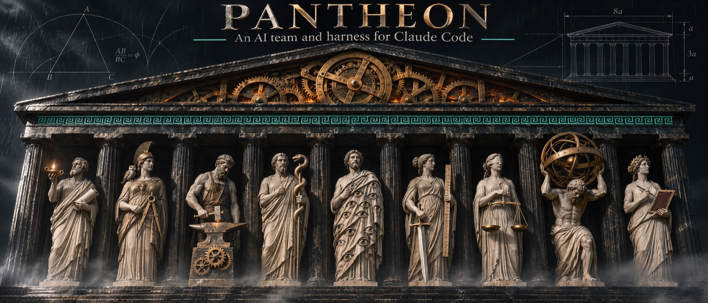

<p align="center">
  
</p>

#  Pantheon

**An AI team and harness for Claude Code.** Nine specialist agents, orchestration commands, agentic-programming skills, a safety hook, and a curated, reproducible collection of ~175 skills (from [skills.sh](https://skills.sh)) and plugins. Install it all, or any part of it, onto any machine with `make`, and remove it again cleanly.

```bash
git clone https://github.com/pooyagolchian/pantheon ~/pantheon && cd ~/pantheon
make plan        # dry run: shows exactly what would change
make install     # core + team + skills
make doctor      # verify
```

## The team

The main session is **Zeus**, the lead: it holds your intent, delegates, integrates and verifies. The specialists are subagents:

| Agent | Role | Edits code | Model |
|---|---|---|---|
| `metis` | researcher: docs (via ctx7), codebase, web | — | sonnet |
| `athena` | architect: design + task plan | — | opus |
| `hephaestus` | builder: implements one task, test-first | ✓ | inherit |
| `asclepius` | debugger: root cause, then fix + regression test | ✓ | inherit |
| `argus` | reviewer: correctness, regressions, silent failures | — | opus |
| `nemesis` | security red team: attack paths | — | opus |
| `themis` | verifier: tests + end-to-end proof | tests | inherit |
| `atlas` | devops: CI/CD, infra, releases (prepares, never fires) | ✓ | inherit |
| `calliope` | writer: README, ADRs, changelogs, PR text | docs | sonnet |

### Commands

| Command | What it does |
|---|---|
| `/assemble <task>` | Full pipeline: scout → plan → build → review → fix → verify |
| `/council [target]` | argus + nemesis + themis review a diff in parallel; one ranked table |
| `/forge <plan>` | Execute a plan task by task, with review per task |
| `/scout <question>` | metis researches and returns a sourced answer |
| `/handoff [path]` | Write `HANDOFF.md` so a fresh session can continue |

### Skills that ship with the team

- `pantheon-orchestration`: when to delegate, how to brief, parallelism, verifying subagents.
- `agentic-workflow`: the explore → plan → implement → verify → commit loop.
- `context-engineering`: CLAUDE.md, rules, skills, hooks and memory, and where each belongs.
- `harness-engineering`: settings, permissions, hooks, agents, plugins and marketplaces.
- `verify-app`: proves a change works by driving the real app (browser, CLI/TUI, HTTP API) against acceptance checks, asserting on state and saving evidence. `themis` uses it.
- `brand`: extracts a brand profile (`BRAND.md`: facts, voice, visual identity, imagery, SEO/AEO entity data) from a website or repo, then writes copy and reviews UI against it. Works for any company, product or personal brand.
- `engineering-principles`: code-craft rules models get wrong: a fail-loud error contract, validating at boundaries, diff discipline, deep modules, and tests that actually assert.
- `backend-service-checklist`: production readiness for services and APIs: timeouts, retries with jitter, idempotency keys, cursor pagination, backpressure, graceful shutdown.
- `typescript-conventions`: a strict tsconfig baseline, narrowing over casting, discriminated unions, branded types, and an explicit error policy.
- `design-principles`: one design reference distilled from the best design skills, with exact numbers for spacing, type, OKLCH color and contrast, motion and states. It resolves the conflicts between sources and lists the AI-UI tells to avoid.

### Works alongside other plugins

Pantheon provides the team and the pipeline. It doesn't re-implement techniques that other plugins already do well. If [superpowers](https://github.com/obra/superpowers) is installed, the agents use its TDD, planning, debugging and worktree skills. For writing and evaluating skills, they use Anthropic's `skill-creator` and `claude plugin eval`.

## What gets installed

| Part | Target (`~/.claude/…`) | Contents |
|---|---|---|
| `core` | `rules/`, `statusline.sh`, `settings.json` | global working rules, ctx7 rule, statusline, `skillOverrides`, guard hook |
| `team` | `agents/`, `commands/`, `skills/` | the Pantheon plugin, symlinked so edits in the repo are live |
| `skills` | `skills/` | `skills/manifest.tsv` installed via skills.sh, plus vendored skills |
| `plugins` | Claude plugin system | marketplaces + plugins from `plugins.tsv` (only with `install-all` / `install-plugins`) |

```bash
make install                         # core + team + skills
make install-all                     # … + plugins
make install-team                    # just one part (also: -core, -skills, -plugins)
make install PROFILES="core frontend"
make uninstall                       # removes only what Pantheon installed
```

### Skill profiles

Every skill in `skills/manifest.tsv` has a profile. Run `make profiles` for counts and `make list` for names.

`core` · `engineering` · `frontend` · `design` · `marketing` · `docs` · `career`

Installing every skill costs context in every session (each description is always loaded), so pick the profiles you need on a given machine. Rarely used skills can be set to `name-only` or `off` in `core/settings.json` → `skillOverrides`.

The `engineering` profile adds vetted third-party skills for security-focused diff review (`differential-review`), API misuse-resistance (`sharp-edges`), property-based testing, API and module design (`api-and-interface-design`, `codebase-design`), performance, Postgres, ADRs, observability, hardening and deprecation. Overlapping or niche skills are `name-only`, mostly in `design` and `frontend`, plus `property-based-testing`, `sharp-edges` and `deprecation-and-migration`. You can still call them by name, but their descriptions no longer load into every session. For design work, `design-principles` names the specialists to load.

### Managing skills

```bash
make search Q=terraform                                   # find on skills.sh
make skill-add SRC=vercel-labs/agent-skills SKILL=web-design-guidelines PROFILE=frontend
make skill-remove SKILL=web-design-guidelines
make update                                               # update skills.sh skills + marketplaces
make capture                                              # re-snapshot this machine into the repo
```

`make capture` reads `~/.agents/.skill-lock.json`, every project `skills-lock.json` under `$HOME`, and `skills/known-sources.tsv` to find each installed skill's upstream. Skills with a known upstream go into the manifest. The rest are copied into `skills/vendor/`. It also refreshes `plugins.tsv` and `skillOverrides`. The `~/.claude/skills/synced` folder (claude.ai sync) is never touched.

## Two ways to install the team

1. **Makefile** (above): the team plus everything else, symlinked, with state tracking.
2. **Plugin marketplace**: the team only, on any Claude Code without cloning:
   ```
   /plugin marketplace add pooyagolchian/pantheon
   /plugin install pantheon@pantheon
   ```
   Commands and agents are then namespaced (`/pantheon:assemble`, `pantheon:athena`). Use one route or the other, not both, or the agents will appear twice. `make doctor` warns if both are present.

The whole team costs about 1.2k tokens of always-loaded context per session (`claude plugin details pantheon`). Agent and skill bodies load only when used.

## Safety model

- **Never clobbers.** If a target already exists, it is skipped and you're told. `FORCE=1` replaces it, after moving the original to `~/.claude/backups/pantheon-<timestamp>/`. Uninstall restores it.
- **Tracked.** Everything created is recorded in `~/.claude/.pantheon/state`. Uninstall removes exactly those entries and nothing else.
- **settings.json is merged, never replaced.** It is backed up before the first write. Your values always win. Uninstall removes only keys Pantheon added, and only if you haven't changed them since.
- **Dry run first.** `make plan` or `DRY_RUN=1 make <target>`.
- **Tested.** `make test` installs into a throwaway `HOME` pre-seeded with clashing user files. It checks the result, then uninstalls and requires `~/.claude` to be byte-identical to before. It also checks skill quality: name format, size, linked references, and that no two skills compete for the same trigger.
- **Guard hook.** `plugins/pantheon/hooks/guard.sh` blocks `rm -rf /` or `~`, force-push to main/master, `mkfs`, raw disk writes and fork bombs. It is deliberately narrow.

## Layout

```
.claude-plugin/marketplace.json   this repo is a Claude Code plugin marketplace
plugins/pantheon/                 the team plugin: agents/ commands/ skills/ hooks/
core/                             rules/, statusline.sh, settings.json fragment
skills/manifest.tsv               profile · source · skill   (skills.sh sources or "vendor")
skills/known-sources.tsv          upstreams for skills installed before skills.sh kept a lock
skills/vendor/                    skills with no known upstream
plugins.tsv                       marketplaces + plugins
bin/pantheon                      the installer (bash 3.2 compatible; Makefile wraps it)
scripts/capture.sh                snapshot this machine into the repo
tests/                            lint + install/uninstall round-trip
docs/best-practices.md            the Claude Code practices this harness encodes
```

## Requirements

`git`, `jq`, `node`/`npx` (≥ 18; skills CLI pinned to `skills@1.5.18`, which runs on Node 20; newer versions need Node ≥ 22.20 — override with `SKILLS_VERSION=`), and `claude` for plugins and validation. Run `make doctor` to check.

## License

Pantheon's own files are MIT. Skills in `skills/vendor/` and those installed from the manifest keep their authors' licenses.

<p align="center">
  
</p>
