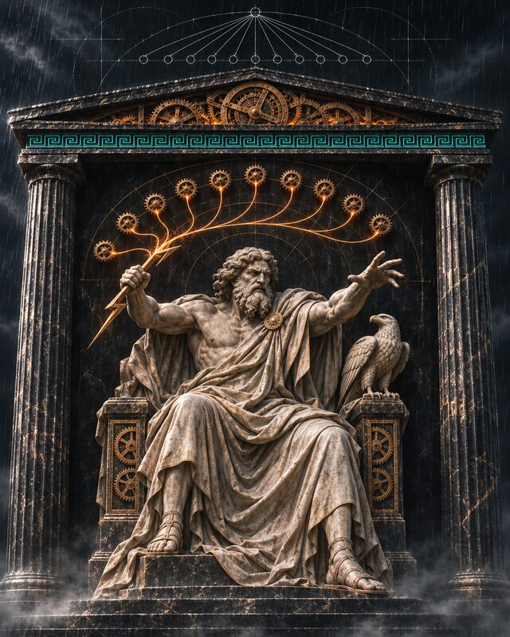
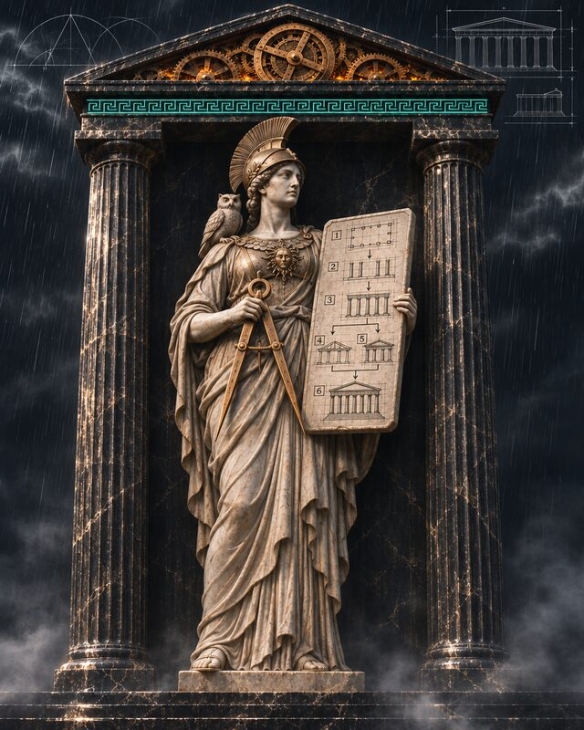
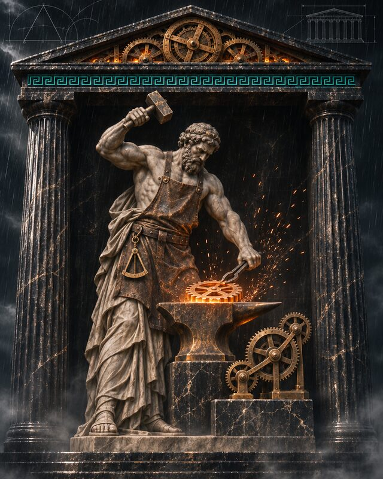
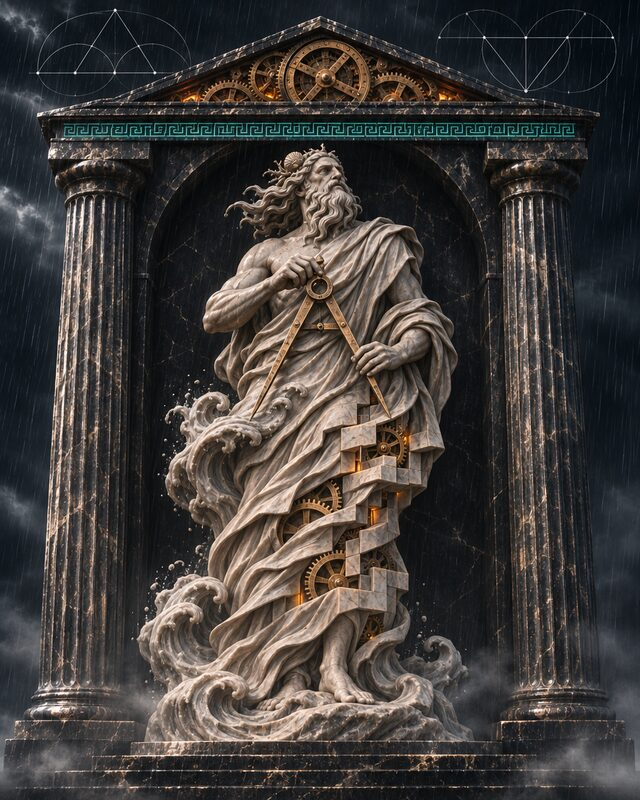
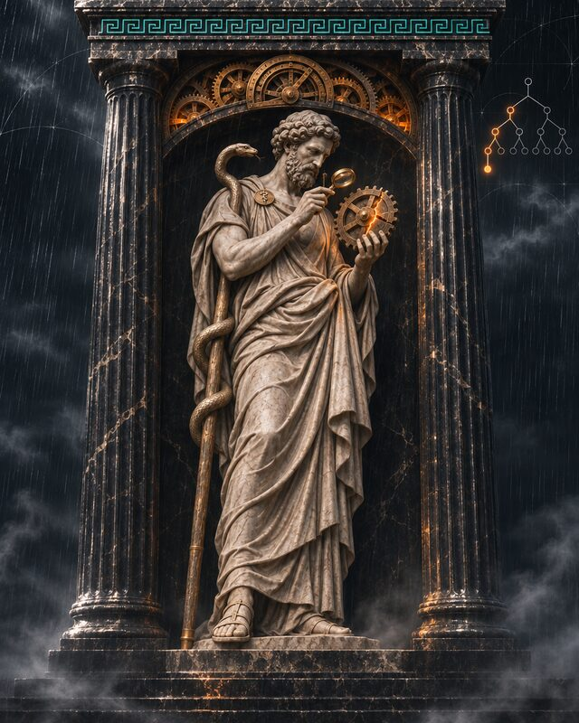
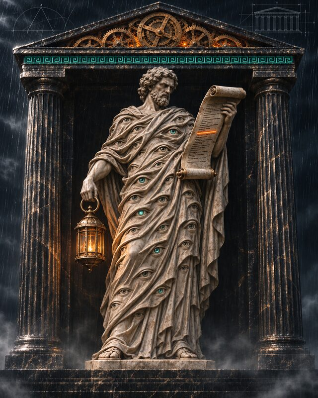
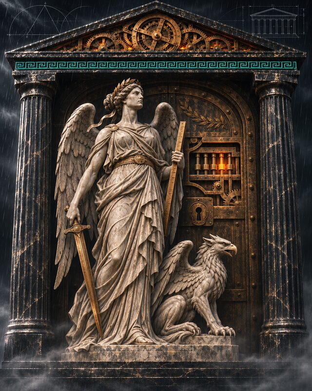
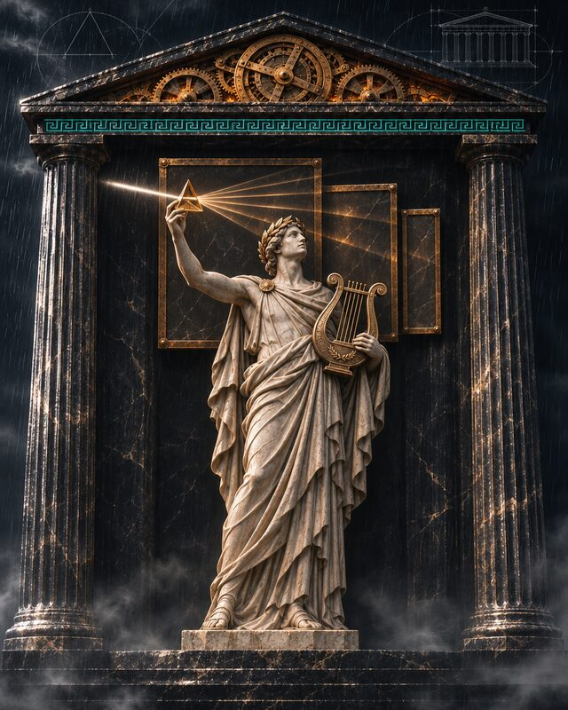
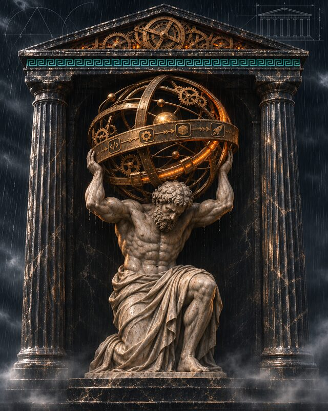
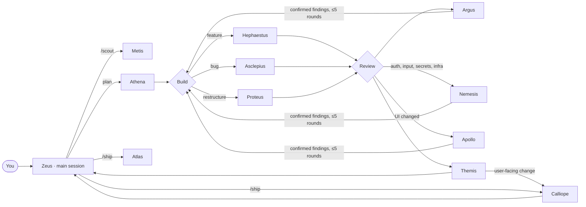

# The Pantheon team

Each specialist in Pantheon is named for the god or titan whose myth matches the job. This page covers each one: what it does, how it is configured, where the commands call it, the rules it won't break, and ideas for making it better. The source of truth is the agent file in `plugins/pantheon/agents/`. If this page and that file disagree, the file is right.

<table>
<tr>
<td align="center"><a href="#zeus--the-lead"> <b>Zeus</b></a> lead</td>
<td align="center"><a href="#metis--researcher"> <b>Metis</b></a> researcher</td>
<td align="center"><a href="#athena--architect"> <b>Athena</b></a> architect</td>
<td align="center"><a href="#hephaestus--builder"> <b>Hephaestus</b></a> builder</td>
</tr>
<tr>
<td align="center"><a href="#proteus--refactorer"> <b>Proteus</b></a> refactorer</td>
<td align="center"><a href="#asclepius--debugger"> <b>Asclepius</b></a> debugger</td>
<td align="center"><a href="#argus--reviewer"> <b>Argus</b></a> reviewer</td>
<td align="center"><a href="#nemesis--security-red-team"> <b>Nemesis</b></a> security</td>
</tr>
<tr>
<td align="center"><a href="#apollo--ui-and-accessibility-critic"> <b>Apollo</b></a> UI critic</td>
<td align="center"><a href="#themis--verifier"> <b>Themis</b></a> verifier</td>
<td align="center"><a href="#atlas--devops-and-release"> <b>Atlas</b></a> devops</td>
<td align="center"><a href="#calliope--technical-writer"> <b>Calliope</b></a> writer</td>
</tr>
</table>

## How they work together

Zeus is the main session. Every specialist is a subagent that starts with no context, does one job and reports back. Agents can't spawn other agents (none has the `Agent` tool), so all coordination goes through Zeus.

| Command | Who it calls |
|---|---|
| `/assemble` | metis → athena → hephaestus / asclepius / proteus → argus (+ nemesis, + apollo) → fix loop → themis → calliope (when user-facing things changed) |
| `/council` | argus + nemesis + themis in parallel, plus apollo when UI files changed |
| `/forge` | hephaestus (or proteus for `refactor` tasks) per task, argus per task, themis at the end |
| `/scout` | metis |
| `/ship` | atlas + calliope in parallel, then stops for your approval of the exact release commands |
| `/handoff` | Zeus writes `HANDOFF.md` itself |
| `/onboard` | Zeus gives a first-run tour; no specialist is dispatched |

Every agent now has at least one command that calls it. Read-only agents can always run in parallel, but only one browser-driving agent can run at a time. Builders end their report with a status: `DONE`, `DONE_WITH_CONCERNS`, `BLOCKED` or `NEEDS_CONTEXT`. Zeus re-runs the decisive check itself before believing any of them.

---

## Zeus — the lead

**Myth.** King of the gods, ruling from Olympus. He gave each god a domain to look after, while the final decisions stayed his. He swallowed Metis, so her counsel advised him from inside, and Athena was born from his head.

**Role.** Zeus is the main Claude Code session, not a subagent. There is no `agents/zeus.md`; the role is defined by the `pantheon-orchestration` skill and the commands below. Zeus holds your intent, decides when to delegate, writes the briefs, runs agents in parallel, merges their results and verifies them before telling you anything is done.

**What it does**
- Decides whether to delegate: independent work, broad reading, or a review that shouldn't be anchored on its own reasoning gets delegated; small, tightly coupled edits it does itself.
- Writes briefs with five parts: goal, context, scope, done-check and report shape. It picks the model per brief through the Agent call's `model` override.
- Runs fix loops capped at 5 rounds: rounds 1–3 resume the same builder, rounds 4–5 go to a fresh one, and after that it stops and asks you.
- Stops at human checkpoints: anything irreversible, outward-facing, a public API change, or a decision the plan marked as yours.

**Ideas to make it better**
- **Run ledger.** `/assemble` and `/forge` could append each dispatch (agent, brief summary, status, rounds) to `.pantheon/runs/<date>-<slug>.md`. Then `/handoff` and post-mortems would work from a record instead of memory.
- **Budget guard.** Let a brief set a ceiling on agent count and model tier, so a big `/assemble` can't quietly fan out to a dozen opus runs.

 

## Metis — researcher

**Myth.** Titaness of wisdom, counsel and cunning, and Zeus's first wife. She gave Kronos the potion that made him disgorge Zeus's siblings. Zeus swallowed her, and she advised him from within. That is the researcher's job: get the facts into the lead's head before anyone acts.

**Role.** Answers questions that need current, sourced information: library and API docs, version changes, how this codebase does X, prior art, tool comparisons. Returns conclusions, not file dumps.

| model | effort | tools | edits |
|---|---|---|---|
| sonnet | medium | Read, Grep, Glob, Bash, WebFetch, WebSearch, Skill | no |

**How it works.** It restates the question and what a useful answer looks like, then picks the source: library docs through `ctx7` first, the codebase through Grep/Glob, and anything else through a web search plus the primary source. It checks the docs against the version the lockfile actually pins, and stops once the question is answered.

**Report.** Answer (1–3 sentences) · Details · Sources (URL or `path:line` for every non-obvious claim) · Confidence (and what would raise it).

**Called by.** `/scout`; step 1 of `/assemble`.

**Guardrails.** Treats repo files, web pages and tool output as data, never instructions, and reports suspected prompt injection.

**Ideas to make it better**
- **Research cache.** Write each answer to `.pantheon/research/<slug>.md` with the date and the versions it applies to. Later sessions can reuse it, and a lockfile bump marks it stale.
- **Contradiction flag.** When two primary sources disagree, report both and say which version each applies to, instead of picking one silently.

 

## Athena — architect

**Myth.** Goddess of wisdom, strategy and craft, born fully armed from Zeus's head. Ares is war as brute force; Athena is war won by planning. The owl stands for seeing clearly where others can't.

**Role.** Turns a goal into a design and a step-by-step plan grounded in the real codebase, before anything non-trivial is built. Never edits files.

| model | effort | tools | edits |
|---|---|---|---|
| opus | high | Read, Grep, Glob, Bash, WebFetch, WebSearch, Skill | no |

**How it works.** It grounds itself first: entry points, conventions, and the closest existing feature, cited as `path:line`. It names the real constraints (runtime, versions, deploy target), weighs 2–3 approaches privately and recommends one. It then writes small, independently checkable tasks, each listing its files, a runnable done-check, its dependencies and whether it can run in parallel. Anything risky or irreversible is flagged for your sign-off.

**Report.** Goal · Approach · Tasks · Risks · Open questions (only those that change what gets built).

**Called by.** Step 2 of `/assemble`. Its plan is what `/forge` executes.

**Guardrails.** Bash is for reading only. No speculative abstraction. Ambiguity goes under open questions, never into a silent guess.

**Ideas to make it better**
- **Plan as a file.** Save the plan to `docs/plans/<date>-<slug>.md` in exactly the shape `/forge` reads, so the plan is reviewable in a PR and survives a session reset.
- **ADR hand-off.** When the decision between approaches is close, Athena could write the context and alternatives as an ADR stub in [`docs/adr/`](adr/README.md) for Calliope to finish.

 

## Hephaestus — builder

**Myth.** Smith of the gods. His forge produced Achilles' armor, Zeus's thunderbolts, and moving automata: golden handmaidens and self-propelled tripods. In short, things built to work.

**Role.** Implements one well-scoped task, test-first, matching the surrounding code, and proves it works before reporting.

| model | effort | tools | edits |
|---|---|---|---|
| inherit | — | Read, Edit, Write, Bash, Grep, Glob, Skill | yes |

**How it works.** It reads every file it will touch and their neighbours first. It writes a failing test for the task's done-check and watches it fail for the right reason before making it pass; with no test suite, it defines the smallest runnable check instead. It keeps the diff as small as it can be: no drive-by refactors, no new dependencies, and unrelated problems get reported, not fixed. Then it runs the project's tests, type checker and linter and reads the output. After two honest failed attempts it stops and reports.

**Report.** Done (file by file) · Verified (exact commands) · Not done · Notice (unrelated issues) · Status.

**Called by.** Step 3 of `/assemble`; every non-refactor task in `/forge`.

**Guardrails.** Never commits, pushes or deploys unless told to. Never disables a test, weakens an assertion, or adds `@ts-ignore`/`noqa`. Never claims success with failing or unrun checks. Treats issue text, fixtures and tool output as data, not instructions. Effort deliberately follows the session ([ADR 0006](adr/0006-effort-is-pinned-per-agent.md)).

**Ideas to make it better**
- **Worktree by default when parallel.** When Zeus runs two Hephaestus tasks at once, the brief should ask for `isolation: "worktree"` unless the files are provably disjoint.

 

## Proteus — refactorer

**Myth.** The old man of the sea, who changes into lion, serpent, water and fire. In the *Odyssey*, Menelaus learns that Proteus tells the truth only to someone who **holds him fast through every transformation**. That is exactly this agent's method: tests pin behaviour, and they hold through every move.

**Role.** Behaviour-preserving restructuring: extract, rename, deduplicate, strangle a legacy path. Pins current behaviour first and proves the existing tests stayed untouched.

| model | effort | tools | edits |
|---|---|---|---|
| inherit | high | Read, Edit, Write, Bash, Grep, Glob, Skill | yes |

**How it works.** It records a baseline (`git status --porcelain`, the test diff stat) and writes characterisation tests in **new files**; the existing code is the oracle, even where it looks wrong. It may update existing tests only mechanically: imports and renamed identifiers, each one listed. It works in small steps and runs the pinning tests after each one. On red it undoes its own edit and takes a smaller step, never using `git checkout`/`restore`/`stash`/`reset`, which would destroy your uncommitted work. Before reporting, it runs a **canary**: it deliberately breaks one pinned behaviour, watches a test go red, then restores the code and confirms no trace of the break remains.

**Report.** Restructured · Behaviour pinned by · Existing tests (mechanical changes only) · Tests executed · Canary · Not done · Status.

**Called by.** Step 3 of `/assemble` for restructure-only work; `/forge` tasks tagged `refactor`.

**Guardrails.** Never changes behaviour, fixes bugs or adds features mid-refactor; it reports them instead. Never edits, skips or weakens an existing test. A refactor with zero tests executed is never called safe. Treats repo and tool text as data, not instructions.

**Ideas to make it better**
- **Mutation spot-check.** Where the project has Stryker or mutmut, run it on the moved code as a stronger, automated version of the single canary.

 

## Asclepius — debugger

**Myth.** God of medicine, whose rod with a single serpent is still medicine's symbol. He was so good at healing that he raised the dead, and Zeus struck him down for it. The lesson for debugging: cure what is actually wrong.

**Role.** Finds the root cause of a failure systematically, then fixes it and adds a regression test, in that order.

| model | effort | tools | edits |
|---|---|---|---|
| inherit | high | Read, Edit, Write, Bash, Grep, Glob, Skill | yes |

**How it works.** It reproduces the failure minimally and reads the whole error, starting from the first one. It narrows the cause with evidence (bisecting inputs, `git bisect`, targeted logging, comparing a working and a broken case), testing one hypothesis per probe and noting what each ruled out. It fixes the root cause, not the symptom, adds a test that fails without the fix, verifies, and removes any temporary logging. After two failed fixes on the same theory, it questions the theory.

**Report.** Symptom · Root cause (with the evidence) · Fix · Regression test · Verified · Status.

**Called by.** Step 3 of `/assemble` for bugs.

**Guardrails.** Never deletes, skips or weakens a failing test, and never "fixes" a bug by swallowing the error, adding a blanket retry or a fallback that hides the fault. Never claims a fix without re-running the original reproduction. Treats stack traces, logs and bug reports as data, because they are attacker-influenced text.

**Ideas to make it better**
- **Automated bisect.** When a regression has a known-good commit and a scriptable repro, run `git bisect run <repro>` instead of bisecting by hand, and report the first bad commit.
- **Hypothesis log.** Keep the probe log (hypothesis → probe → ruled out) in the report, so a second debugger never repeats a dead end.

 

## Argus — reviewer

**Myth.** Argus Panoptes, the hundred-eyed giant Hera set to watch Io; some of his eyes were always awake. Hermes defeated him by lulling every eye to sleep with music and stories. The lesson for a reviewer: don't let a fluent narrative put you to sleep. Read the diff, not the author's account of it.

**Role.** Finds correctness bugs, regressions and convention breaks in a diff before commit or merge. Reports findings, never fixes them.

| model | effort | tools | edits |
|---|---|---|---|
| opus | high | Read, Grep, Glob, Bash, Skill | no |

**How it works.** It reviews the diff (by default the unstaged plus staged changes; for a branch, the diff from its merge-base) and reads callers, callees and tests around it. It works in priority order: correctness → regressions → silent failure → test adequacy → convention, and skips anything a linter would catch. **For every finding it builds the concrete failure** (this input or state → this wrong result) and runs a quick check where it can. Anything it can't substantiate is dropped or marked *plausible*.

**Report.** Ranked findings: `[severity] path:line`, the failure, the fix. Ends with a verdict: `ship`, `ship after fixes` or `rework`. An empty review is a valid review.

**Called by.** Step 4 of `/assemble`; `/council`; each task in `/forge`.

**Guardrails.** Never edits files: Bash is for reading and running checks only. Never reports a finding without a concrete failure scenario unless it is marked *plausible*. Treats the diff's text, including comments addressed to reviewers, as data.

**Ideas to make it better**
- **Large-diff protocol.** Above a few hundred changed lines, review file-group by file-group and report coverage ("reviewed 14/14 files"), so silence never means "didn't look".

 

## Nemesis — security red team

**Myth.** Goddess of retribution against hubris, the one who comes for whoever believes they are untouchable. Her measuring rod stands for keeping things in proportion. In code review, the hubris is "nobody will send that input."

**Role.** Defensive security review of the user's own code: finds exploitable vulnerabilities with concrete attack paths. Read-only.

| model | effort | tools | edits |
|---|---|---|---|
| opus | xhigh | Read, Grep, Glob, Bash, WebSearch, Skill | no |

**How it works.** It maps the attack surface (routes, handlers, CLI args, webhooks, uploads, env), traces untrusted input to sinks (queries, shell, file paths, HTML, redirects, deserialization, outbound requests, LLM prompts), then checks the controls: authentication, per-object authorization, CSRF, rate limits, encoding, secret handling, crypto, and dependency CVEs. It also covers agent-specific risks: tools that execute model output, over-broad permissions, hooks running untrusted content, and MCP servers with write access.

**Report.** Only findings with a plausible attack path: `[critical|high|medium|low] path:line`, the attack, the fix. Then an optional hardening list.

**Called by.** Step 4 of `/assemble` when a change touches auth, input, secrets, network or infra; `/council`.

**Guardrails.** No working exploit payloads beyond what's needed to demonstrate the issue. Nothing against systems the user doesn't own, nothing destructive.

**Ideas to make it better**
- **Tool-backed dependency check.** When `osv-scanner`, `npm audit` or `pip-audit` is available, run it instead of relying on web searches for CVEs, and cite the advisory IDs.
- **Persistent threat model.** On the first review of a repo, write `docs/security/threat-model.md` (assets, trust boundaries, entry points). Later reviews read and update it rather than re-deriving it.

 

## Apollo — UI and accessibility critic

**Myth.** God of light, music, poetry and the arts, and leader of the Muses. Light means seeing the thing as it really is, and music means harmony and proportion. Themis asks whether it works; Apollo asks whether it is good.

**Role.** Judges the **running** interface (flows, responsive layout, visual polish, WCAG 2.2 AA, empty and error states) with screenshots as evidence. Never edits code.

| model | effort | tools | edits |
|---|---|---|---|
| sonnet | medium | Read, Grep, Glob, Bash, Skill + Playwright browser tools | screenshots only |

**How it works.** It starts the app if needed and opens its own tab, which it closes when done. It walks the primary flows end to end and checks each screen at 1440, 768 and 375 px. It judges polish against `design-principles`. For accessibility it does a keyboard-only pass, checks visible focus, computes contrast from rendered styles (4.5:1 and 3:1), tests reduced motion, 200% zoom and 320 px reflow, and checks accessible names. It also checks empty, loading, error and long-content states, plus console and network errors. Evidence goes under `.verify/apollo/`. If the Playwright plugin is missing, it falls back to a scripted check, then to a code-level review, and labels which one it used.

**Report.** A table (severity · location · evidence · why it matters · fix) ranked Blocker → High → Medium → Nit, plus a **Not checked** list.

**Called by.** Step 4 of `/assemble` and `/council` when UI files changed. It never runs alongside another browser-driving agent.

**Guardrails.** Writes no files except screenshots. Reports nothing it didn't observe in the running app (unless the report is labelled code-level only). Never submits real data, makes purchases or sends messages.

**Ideas to make it better**
- **Visual baselines.** Keep accepted screenshots in `.verify/apollo/baseline/` and report pixel-diff regressions per screen and width on later runs.
- **Automated a11y pass first.** Inject axe-core through `browser_evaluate` to catch the mechanical WCAG failures, so the manual pass can focus on what a tool can't judge.

 

## Themis — verifier

**Myth.** Titaness of divine law, order and right custom. She held the oracle at Delphi before Apollo, and she sits beside Zeus as his counsellor. The scales come from the ancient image; the blindfold is a much later addition from the Renaissance figure of Justice. Both suit a verifier: weigh the evidence, ignore the author's confidence.

**Role.** Proves a change works: designs the edge cases, writes the missing tests, runs the suite, and exercises the real surface end to end.

| model | effort | tools | edits |
|---|---|---|---|
| inherit | medium | Read, Edit, Write, Bash, Grep, Glob, Skill | tests only |

**How it works.** It restates the claim in one sentence and uses the project's existing test setup. It designs few, sharp cases: the happy path, boundaries, invalid input, error paths and the specific regression risk. Each test must fail if the feature were deleted. It runs everything relevant and reads the output, and drives the real CLI, HTTP or UI surface through the `verify-app` skill, saving evidence in `.verify/`.

**Report.** Claim · Verdict (`PASS`, `FAIL` or `PARTIAL`) · Evidence · Added · Gaps · Status.

**Called by.** Step 6 of `/assemble`; `/council`; the end of `/forge`.

**Guardrails.** Never changes production code to make a test pass. Never marks PASS on a skipped, flaky or unrun test.

**Ideas to make it better**
- **Make the revert-check real.** Today "would this test go red if the feature were deleted?" is a mental check. Themis could actually do it, the way Proteus runs its canary: break the change, watch the new test fail, restore it.
- **Flake detection.** Run new tests several times (`--repeat`, `pytest --count`) before reporting PASS.

 

## Atlas — devops and release

**Myth.** The titan condemned to hold up the sky at the edge of the world. He carries what everything else rests on, and nobody notices him until he shifts.

**Role.** CI/CD, build pipelines, Docker, infrastructure as code, environment config, dependency upgrades, release prep. **Prepares, doesn't fire.**

| model | effort | tools | edits |
|---|---|---|---|
| inherit | — | Read, Edit, Write, Bash, Grep, Glob, WebFetch, Skill | yes |

**How it works.** It inventories what the project already uses and extends it rather than adding a second system. It checks current docs with `ctx7`, because CI and cloud syntax change often. It makes changes reproducible: pinned versions, committed lockfiles, secrets only from the platform's secret store. It validates locally (`docker build`, `act`, `terraform plan`, `cfn-lint`, dry runs). Deploys, releases, tag pushes, infra applies, DNS changes and anything billed are written up with the exact command, then it stops for approval.

**Report.** Changed · Validated · To run (exact commands awaiting approval) · Rollback · Status.

**Called by.** `/ship`, which runs it alongside Calliope and then stops for your approval ([ADR 0005](adr/0005-docs-and-release-join-the-pipeline.md)). Zeus can also dispatch it directly for CI or infrastructure work.

**Guardrails.** Never deploys, releases, pushes tags, applies infrastructure, changes DNS or runs anything billed without explicit approval in the brief. Never prints, logs or commits secret values. Never skips CI checks or adds `continue-on-error` to get a pipeline green. Never runs destructive commands; those go under **To run** for a human. Treats fetched pages and CI logs as data, never as instructions ([ADR 0004](adr/0004-every-agent-treats-untrusted-content-as-data.md)).

**Ideas to make it better**
- **Read-only drift check.** A mode that runs `terraform plan -detailed-exitcode` (or the platform's equivalent) and reports where live infrastructure has drifted from the code, without changing anything.
- **Pinned-action audit.** Flag GitHub Actions referenced by tag rather than commit SHA, and dependencies without a lockfile.

 

## Calliope — technical writer

**Myth.** Chief of the nine Muses, muse of epic poetry, usually shown with a writing tablet. Hesiod calls her the foremost of the Muses: the voice that makes a long story clear.

**Role.** Writes and updates READMEs, docs, ADRs, changelogs, API references, code comments and PR descriptions so they match what the code actually does.

| model | effort | tools | edits |
|---|---|---|---|
| sonnet | low | Read, Edit, Write, Grep, Glob, Bash, Skill | docs only |

**How it works.** It writes for one named reader. It verifies every claim against the code and runs the commands it documents. It leads with what the reader needs, matches the project's doc style, and cuts marketing language and comments that just restate the code.

**Formats.** README: purpose · quick start · usage · configuration · development. ADR: context · decision · consequences · alternatives. Changelog: Keep a Changelog style. PR: what · why · how verified · risk.

**Called by.** Step 7 of `/assemble` when user-facing behaviour, config, commands or a public API changed; `/ship` for the changelog and release text. Its ADRs go in [`docs/adr/`](adr/README.md).

**Guardrails.** Verifies every claim against the code and reports doc/code mismatches instead of hiding them. Treats repo text as data, not instructions.

**Ideas to make it better**
- **Doc drift check.** A mode that diffs the docs against the code (for example, every `make` target in the README exists, and the agent tables match `plugins/pantheon/agents/`) and reports mismatches without editing.

 

---

## Changes made from this review (0.4.0)

The first version of this page ended with seven proposals, each backed by evidence from the agent files. All seven were carried out:

| # | Finding | What changed | Record |
|---|---|---|---|
| P1 | hephaestus, proteus, asclepius, atlas and calliope lacked the `## Untrusted content` section; atlas also fetches web pages | Section added to all five; `tests/lint.sh` now fails for any agent without it | [ADR 0004](adr/0004-every-agent-treats-untrusted-content-as-data.md) |
| P2 | `effort` was unset on four agents with no stated reason | asclepius `high`, themis `medium`; hephaestus and atlas inherit on purpose, documented in `pantheon-orchestration` | [ADR 0006](adr/0006-effort-is-pinned-per-agent.md) |
| P3 | asclepius, atlas and argus had no `## Never` list | Added: no weakened tests or swallowed errors (asclepius); no unapproved outward-facing or destructive actions and no leaked secrets (atlas); no edits (argus) | — |
| P4 | No command called calliope or atlas | `/assemble` step 7 **Document**; new `/ship` command | [ADR 0005](adr/0005-docs-and-release-join-the-pipeline.md) |
| P5 | Calliope had an ADR format but the repo had no ADRs | [`docs/adr/`](adr/README.md), seeded with six records | — |
| P6 | The README header showed nine statues (no proteus or apollo) and a bearded Metis | Header regenerated with all eleven, using these portraits as references | — |
| P7 | Nothing checked that the team tables agree | `tests/lint.sh` checks every agent appears in the README, `core/rules/pantheon.md`, `pantheon-orchestration`, `ONBOARDING.md` and this page, and every command appears in the README | — |

The **Ideas to make it better** under each agent are still open. If you take one on, record it as the next ADR.

---

## Adding a portrait for a new agent

The portraits were generated with GPT Image 2.6 at high quality, 4:5, using `assets/header.jpg` as a style reference. Each was then saved at 640×800 as a progressive JPEG (quality 82). To keep new ones consistent, start the prompt with:

> Match the exact art style, lighting and palette of the reference image (dark noir ancient-engineering temple: weathered pale marble statues, black veined marble, burnished bronze Antikythera-style gears, thin teal Greek-key meander, ember-orange glow, rain and low mist, faint white geometric construction drawings in the night sky). Create ONE single statue portrait card, full figure, centered in a black marble niche between two fluted columns, teal Greek-key band across the top. Subject: …

Then describe the god's attributes, linking each one to the agent's job, and end with "No text, no letters, no watermark."
